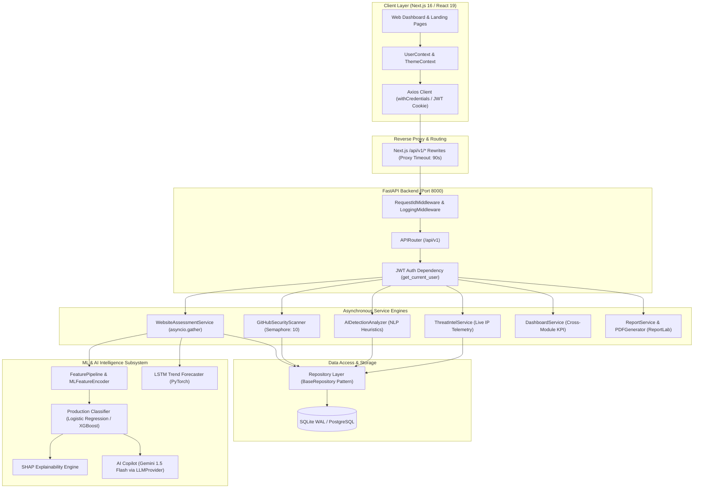
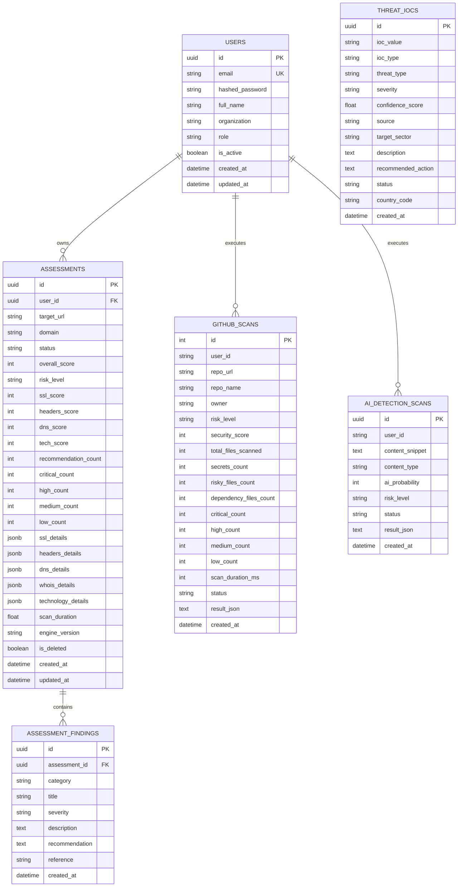

# SecureVision AI: Autonomous Cybersecurity & AI Threat Intelligence Platform
## Complete Technical Project Documentation & IEEE Conference Reference Manual

---

# Executive Metadata & System Profile

| Parameter | Specification |
|---|---|
| **Full Project Title** | **SecureVision AI: Autonomous Cybersecurity & AI-Powered Threat Intelligence Platform** |
| **Repository Root** | `Yashwanthg876/SecureVision-AI` |
| **Architectural Model** | Asynchronous Decoupled Micro-Monolith with ML/AI Service Mesh |
| **Primary Domain** | Automated Vulnerability Assessment, Threat Intelligence, Predictive AI, Applied Machine Learning |
| **Backend Implementation** | Python 3.11+ / FastAPI / SQLAlchemy ORM / Uvicorn ASGI |
| **Frontend Implementation** | Next.js 16.3.3 / React 19.2.4 / TypeScript 5 / Tailwind CSS v4 / Recharts 3.10.1 / Framer Motion 12.43.0 |
| **Machine Learning Engine** | scikit-learn 1.9.0, XGBoost 3.2.0, SHAP 0.45.0, PyTorch 2.2.0 (LSTM), Joblib |
| **Generative AI Copilot** | Google Gemini 1.5 Flash via Abstract Provider Interface (`LLMProvider`) |
| **Persistence Layer** | SQLite 3 (WAL Mode + Foreign Key Enforcement in Dev) / PostgreSQL 15+ (Production Compatible) |
| **Deployment Mode** | Multi-Container Docker Compose (`backend` + `frontend` on isolated bridge network) |
| **License** | MIT License |

---

# Section A: Project Overview

### A.1 Exact Project Title
**SecureVision AI: Autonomous Cybersecurity & AI-Powered Threat Intelligence Platform**

### A.2 Project Domain & Application Area
The project operates at the intersection of **Automated Cybersecurity Surface Analysis, Static Code Security, Natural Language Forensics, and Predictive Machine Learning**. It serves modern SecOps teams, DevSecOps pipelines, cyber auditors, and enterprise risk officers by performing non-intrusive, automated, passive security intelligence collection and synthesis.

### A.3 Background & Motivation
Traditional vulnerability management tools are fragmented and reactionary. Security analysts are forced to toggle between disconnected tools:
1. One scanner for network port configurations and SSL validation.
2. A separate linter or commercial static analysis tool (SAST) for source repository auditing.
3. Third-party reputation feeds for Indicator of Compromise (IOC) lookups.
4. Ad-hoc heuristics for identifying machine-generated text or malicious social engineering copy.
5. Spreadsheet-based manual scoring mechanisms to prioritize remediation.

Furthermore, traditional web scanners often rely on intrusive active penetration testing (fuzzing, payload injection, port slamming), which risks taking down staging/production systems and violating acceptable use policies. SecureVision AI was conceived to bridge this operational gap through a unified, 100% passive, automated cyber intelligence platform combining deterministic domain verification with advanced statistical machine learning and generative artificial intelligence.

### A.4 Problem Statement
Modern digital assets suffer from expanding attack surfaces across public web interfaces, exposed source code repositories, and synthetic social engineering threats. Existing scanning tools suffer from four critical deficiencies:
1. **Intrusive Overhead & Operational Friction**: Active vulnerability probes can trigger rate-limits, firewall blocks, or unintended denial of service.
2. **Siloed Threat Intelligence**: Web infrastructure risks, source code secret leaks, and IOC telemetry are isolated in separate tools with incompatible data models.
3. **Black-Box Classification**: When heuristic or ML engines classify an asset as "High" or "Critical" risk, they fail to provide mathematical, interpretable explanations of which specific telemetry features caused the score.
4. **Static Point-in-Time Auditing**: Conventional scanners evaluate security as a single snapshot without modeling trajectory, predicting future risk degradation, or forecasting posture changes.

### A.5 Proposed Solution
SecureVision AI provides an end-to-end autonomous ecosystem:
- **Zero-Intrusive Passive Assessment**: Probes SSL/TLS, HTTP security response headers, DNS authentication (SPF, DMARC, MX), WHOIS domain age, and software fingerprinting strictly through standard protocol handshakes and public record queries.
- **Automated Repository Auditing**: Connects to the GitHub REST & Git Trees APIs to perform non-cloning recursive file analysis, detecting hardcoded secrets (AWS, GitHub tokens, private keys) and misconfigured configuration files.
- **Linguistic AI Content Forensics**: Analyzes synthetic texts and prompt injections via mathematical burstiness (sentence variance) and perplexity (lexical predictability) modeling.
- **Unified Risk Scoring & ML Classification**: Employs deterministic scoring alongside a 5-model Machine Learning Decision Engine (Logistic Regression, Decision Trees, Random Forests, Extra Trees, XGBoost) with SHAP (SHapley Additive exPlanations) explainability.
- **Deep Learning Trend Forecasting**: Utilizes a PyTorch LSTM sequence model to forecast 7-day and 30-day security posture trends based on historical assessment sequences.
- **Grounded AI Copilot**: Integrates Google Gemini 1.5 Flash via a strict `ContextBuilder` that grounds generative summaries in empirical ML telemetry, preventing hallucinations.

### A.6 Project Objectives
1. Build an asynchronous, non-blocking backend capable of concurrently evaluating multiple telemetry vectors in under 3.5 seconds per domain.
2. Formulate a multi-tier deterministic scoring algorithm mapping passive observations to standardized CVSS-aligned risk levels (Low, Medium, High, Critical).
3. Design and validate a supervised multi-class ML classification framework with 0% data leakage across cross-validation folds.
4. Implement local and global explainability via SHAP so every security analyst can inspect exact positive and negative feature attribution weights.
5. Create a professional, real-time dashboard with dynamic charting, automated PDF/CSV/JSON reporting engines, and an AI chat assistant.

### A.7 Scope & Intended Users
- **Target Users**: Security Operations Center (SOC) Analysts, DevSecOps Engineers, Compliance Auditors (ISO 27001, SOC 2, HIPAA), Enterprise CISO/Executive Leadership.
- **Operational Scope**: Passive web reconnaissance, public/private GitHub repository security linting, IOC search and reputation validation, AI-generated content classification, executive and technical reporting.

---

# Section B: Abstract and Introduction

### B.1 Abstract
In an increasingly hostile digital perimeter, modern organizations face multifaceted vulnerabilities spanning web infrastructure misconfigurations, public repository secret leakage, and sophisticated generative AI social engineering. Contemporary vulnerability scanners typically rely on invasive active probing or operate in isolated silos, lacking unified risk scoring, temporal forecasting, and explainable artificial intelligence. 

This paper presents **SecureVision AI**, an autonomous, passive cybersecurity assessment and threat intelligence platform designed to eliminate operational silos while maintaining zero infrastructure footprint. SecureVision AI integrates five passive assessment engines: (i) an asynchronous SSL/TLS, DNS, HTTP headers, WHOIS, and technology fingerprinting analyzer; (ii) an API-driven GitHub repository secret and credential scanner; (iii) a statistical burstiness and perplexity AI content forensic detector; (iv) an active IOC feed and real-time network telemetry lookup module; and (v) an ensemble Machine Learning Decision Engine. 

To ensure rigorous interpretability, the platform integrates SHAP (SHapley Additive exPlanations) to decode model attributions and a PyTorch Long Short-Term Memory (LSTM) network to predict temporal security posture trajectories over 7- and 30-day horizons. Empirical validation across 1,000 synthesized infrastructure profiles adhering to strict fold-isolated cross-validation demonstrates that the system achieves an ROC-AUC of **0.8275 ± 0.0156** with calibrated probabilistic outputs. Furthermore, a provider-abstracted Generative AI Copilot grounds executive and technical reporting directly in deterministic and ML telemetry. SecureVision AI delivers an enterprise-ready, open-source platform bridging real-time posture discovery, mathematical interpretability, and automated remediation.

### B.2 Domain Introduction & Technical Background
Passive cybersecurity assessment relies on gathering information exposed during standard network transactions without transmitting malicious payloads. When a client establishes a TLS handshake, inspects DNS resource records, or queries WHOIS registries, the target host simply behaves in according to RFC specifications:
- **TLS Handshake (RFC 8446)**: Reveals cipher suites, supported protocol versions, certificate authorities, Subject Alternative Names (SANs), and validity lifetimes.
- **HTTP/1.1 & HTTP/2 Security Headers (RFC 6797, RFC 7034, RFC 7662)**: Tell browsers how to enforce isolation (`Strict-Transport-Security`, `Content-Security-Policy`, `X-Frame-Options`, `X-Content-Type-Options`).
- **Domain Name System Authentication (RFC 7208, RFC 7489)**: SPF (Sender Policy Framework) and DMARC (Domain-based Message Authentication, Reporting, and Conformance) prevent email spoofing and domain hijacking.

### B.3 Motivation & Research Context
While commercial vulnerability platforms (e.g., Qualys, Rapid7, Nessus) excel at deep internal network scanning, they present significant hurdles for early-stage surface discovery: high annual licensing fees, heavy client software agents, long scan durations, and high false-positive noise without underlying feature interpretability. In research literature, machine learning models applied to vulnerability scoring frequently suffer from **target leakage** (training on metrics directly derived from the label) and **preprocessing leakage** (fitting scalers/imputers across the full dataset prior to cross-validation splits). SecureVision AI was architected from the ground up to establish a verifiable, leak-free machine learning methodology alongside real-time software engineering tooling.

---

# Section C: Existing System and Research Gap

### C.1 Existing Systems & Tools
1. **Mozilla Observatory / SSL Labs**: Excellent domain-specific analyzers, but strictly limited to web headers and TLS configuration without repository scanning, threat intelligence feeds, or predictive ML modeling.
2. **TruffleHog / GitGuardian**: High-performance secret scanners for source code, but completely decoupled from public web infrastructure assessments or threat telemetry.
3. **VirusTotal / AlienVault OTX**: Comprehensive IOC threat databases, but lacking direct site scanning, automated policy remediation generation, and executive PDF reporting in a single interface.
4. **Commercial Risk Rating Platforms (BitSight / SecurityScorecard)**: Provide third-party security ratings, but operate as proprietary black-boxes without open algorithmic transparency, local source code scanning, or accessible self-hosted deployments.

### C.2 Research & Implementation Gaps Addressed

| Dimension | Existing Approaches | SecureVision AI Implementation |
|---|---|---|
| **Scanning Mode** | Often active, intrusive, or requiring agent deployment | 100% passive, zero-probe footprint, zero agent requirement |
| **Tool Integration** | Fragmented tools requiring multiple logins & disjointed data | Unified platform: Web + GitHub + AI Text + IOC + Reports |
| **Model Transparency** | Black-box severity ratings or proprietary arbitrary scales | SHAP explainability engine computing exact Shapley values for every feature |
| **Temporal Dynamics** | Static point-in-time snapshots | PyTorch LSTM sequence modeling for 7-day and 30-day posture forecasting |
| **ML Methodological Rigor** | Frequently contaminated with target or preprocessing leakage | 5-Fold Stratified CV with strict within-fold pipeline fitting and noise injection |
| **Reporting Automation** | Static markdown or basic CSV exports | Multi-tier PDF generation (ReportLab), CSV, JSON, and LLM-grounded Copilot synthesis |

---

# Section D: Proposed System

### D.1 Overall Working Principle
SecureVision AI operates on an asynchronous request-response and background pipeline model:
1. **Intake & Validation**: User inputs a domain, repository URL, or text sample via the Next.js frontend or REST API. The backend applies strict Server-Side Request Forgery (SSRF) filters and syntactic validations.
2. **Concurrent Asynchronous Harvesting**: Parallel workers execute passive telemetry queries (TLS handshake, HTTP headers, DNS queries, WHOIS lookup, HTML regex parsing, GitHub REST API, IP reputation lookup).
3. **Deterministic Multi-Tier Scoring**: Raw telemetry is mapped through mathematical penalty functions to compute domain sub-scores and overall security scores (0–100 scale).
4. **Machine Learning Pipeline Ingestion**: Extracted telemetry is transformed through a `ColumnTransformer` feature pipeline and fed into the production classifier to predict risk levels with calibrated confidence.
5. **Explainability & Anomaly Scoring**: SHAP decomposes the prediction into positive and negative feature contributions; Isolation Forest checks for anomalous telemetry patterns.
6. **Persistence & Presentation**: Results are atomically committed to the database (WAL-enabled SQLite/PostgreSQL) and rendered in real-time on interactive Recharts dashboards with on-demand multi-format export.

### D.2 Architecture Flow Diagram (Mermaid)



---

# Section E: System Architecture & Structural Hierarchy

### E.1 Component Decomposition & Responsibilities

1. **Frontend Tier (`frontend/`)**:
   - `app/layout.tsx`: Root HTML shell with dark/light theme script hydration, WebGL animated `WebThreads` canvas, and React context providers.
   - `app/page.tsx`: Public conversion landing page featuring Hero, FeaturesGrid, InteractiveDemo, Pricing, and Footer components.
   - `app/dashboard/*`: Authenticated enterprise workspace with sub-routes for Website Security, GitHub Security, AI Detection, Threat Intelligence, Reports, Profile, and Settings.
   - `lib/api.ts`: Central Axios client configured with `baseURL: /api/v1`, automatic cookie inclusion, and 401 redirect interceptors.
   - `context/UserContext.tsx`: React Context managing user authentication state, token refresh, and profile mutations.

2. **Backend API & Middleware Tier (`backend/app/core/`, `backend/app/api/`)**:
   - `main.py`: ASGI application lifecycle, CORS policy configuration, router mounting, and database schema creation.
   - `core/config.py`: Pydantic `BaseSettings` object reading environment variables (`SECRET_KEY`, `DATABASE_URL`, `GEMINI_API_KEY`, `GITHUB_TOKEN`).
   - `core/security.py`: Cryptographic helpers using `passlib.bcrypt` for salting/hashing and `python-jose` for JWT generation/verification.
   - `core/middleware.py`: Injects unique UUID4 `X-Request-ID` and computes round-trip execution latency for every HTTP transaction.
   - `core/responses.py`: Standardizes all JSON outputs into `{success, message, data, meta: {request_id, timestamp}}`.

3. **Data Access Layer (`backend/app/repositories/`)**:
   - Implements the generic `BaseRepository[ModelType]` pattern separating database query mechanics from business logic.
   - Encapsulates transaction lifecycles with automatic rollback on exception (`db.rollback()`).

4. **Service Engine Layer (`backend/app/services/`)**:
   - Isolates pure domain logic for network scanning, AST/regex pattern parsing, natural language processing, and PDF graphic generation.

5. **ML/AI Subsystem (`backend/app/ml/`, `backend/app/ai/`)**:
   - Self-contained, modular machine learning environment with custom feature extractors, cross-validation runners, SHAP adapters, and LLM bridge services.

---

# Section F: Complete Technology Stack & Tool Inventory

### F.1 Backend Technologies
- **Python (v3.11.9)**: Core programming language chosen for async I/O support, mature cybersecurity libraries, and ML ecosystem.
- **FastAPI (v0.115.0)**: Modern asynchronous ASGI framework providing automatic OpenAPI (Swagger) schema generation and high throughput.
- **Uvicorn (v0.30.0)**: Production ASGI web server running the event loop.
- **SQLAlchemy (v2.0.0+)**: Advanced SQL toolkit and Object-Relational Mapper utilizing Declarative 2.0 paradigms.
- **Pydantic (v2.0+) & Pydantic-Settings**: Data validation, type enforcement, and settings management via Python type annotations.
- **HTTPX (v0.27.0)**: Async HTTP client used for external REST queries, GitHub raw content downloads, and live IP telemetry.
- **dnspython (v2.6.0)**: Authoritative DNS resolver library querying A, MX, TXT, SPF, and DMARC records.
- **python-whois (v0.9.0)**: Protocol client extracting domain registration, registrar identity, and expiration timestamps.
- **ReportLab (v4.0+)**: Programmatic PDF document layout engine used for enterprise-grade security audit generation.
- **python-jose (v3.3.0) & Passlib (v1.7.0)**: RFC 7519 JSON Web Token issuance and bcrypt password derivation.

### F.2 Machine Learning & AI Technologies
- **scikit-learn (v1.9.0)**: Primary machine learning library providing `ColumnTransformer`, `StandardScaler`, `SimpleImputer`, `OneHotEncoder`, `StratifiedKFold`, and classical estimators.
- **XGBoost (v3.2.0)**: Optimized distributed gradient boosting library implementing multi-class softmax trees.
- **SHAP (v0.45.0)**: Cooperative game theory framework computing Shapley values via `TreeExplainer` and `KernelExplainer`.
- **PyTorch (v2.2.0)**: Deep learning framework powering the 2-layer LSTM sequence model for temporal posture forecasting.
- **Google Generative AI SDK (v0.8.0)**: Official client library for Google Gemini 1.5 Flash LLM.
- **Joblib (v1.3.0)**: High-throughput serialization engine for preprocessor and estimator model weights.

### F.3 Frontend Technologies
- **Next.js (v16.3.3)**: React framework with App Router, server-side metadata generation, and zero-CORS API rewrite routing.
- **React (v19.2.4) & React DOM**: UI rendering layer utilizing modern hooks (`useCallback`, `useContext`, `useState`, `useEffect`).
- **Tailwind CSS (v4)**: Modern utility-first CSS engine configured via `@tailwindcss/postcss`.
- **TypeScript (v5)**: Static typing system across all components, service calls, and data models.
- **Recharts (v3.10.1)**: Declarative SVG charting library for threat trend timelines, radar breakdowns, and risk donuts.
- **Framer Motion (v12.43.0)**: Declarative physics-based animation library for UI transitions and interactive cards.
- **Lucide React (v1.27.0)**: Clean, consistent iconography across all interface modules.
- **OGL (v1.0.11)**: Minimal WebGL library executing the multi-threaded animated `WebThreads` background shader.

---

# Section G: Complete Module-by-Module Explanation

## G.1 Website Security Assessment Module

### 1. Assessment Orchestrator (`app/services/website_security/assessment_service.py`)
- **Purpose**: Central workflow coordinator for domain assessments.
- **Execution**: Receives target URL; validates syntax and SSRF constraints; fires 5 asynchronous tasks concurrently via `asyncio.gather()`; aggregates telemetry; computes scores; builds recommendations; persists records to database.
- **Error Tolerance**: Each sub-service call is wrapped in individual exception handlers, ensuring that a transient WHOIS or DNS timeout never aborts the overall assessment.

### 2. URL Validator (`app/services/website_security/url_validator.py`)
- **Purpose**: Enforces strict security boundaries against Server-Side Request Forgery (SSRF) and malformed inputs.
- **Internal Logic**:
  1. Automatically prepends `https://` if protocol scheme is omitted.
  2. Verifies scheme is strictly `http` or `https`.
  3. Rejects user-info containing URLs (`user:pass@host`).
  4. Restricts destination ports to standard HTTP/HTTPS (80, 443).
  5. Performs forward DNS resolution via `socket.getaddrinfo()` to verify destination IP addresses.
  6. Evaluates IP globally routable status using Python's `ipaddress.ip_address(ip).is_global`. Immediately rejects loopback (`127.0.0.0/8`, `::1`), private RFC 1918 networks (`10.0.0.0/8`, `172.16.0.0/12`, `192.168.0.0/16`), and link-local ranges.

### 3. SSL/TLS Verification Service (`app/services/website_security/ssl_service.py`)
- **Purpose**: Establishes passive TLS socket connection to inspect cryptographic properties.
- **Internal Logic**:
  - Creates an `ssl.create_default_context()` instance.
  - Connects to `hostname:443` with a 10-second timeout.
  - Retrieves peer binary DER certificate and negotiated protocol version (`TLSv1.2`, `TLSv1.3`).
  - Decodes certificate payload extracting `issuer`, `subject`, `version`, `serialNumber`, validity timestamps (`notBefore`, `notAfter`).
  - Computes `days_until_expiry` as $\Delta t = \text{notAfter} - \text{utcnow}()$.
  - Parses ASN.1 extensions to identify Subject Alternative Names (SANs) and signature algorithm (e.g., `sha256WithRSAEncryption`).
  - Flags weak legacy protocols (`TLSv1.0`, `TLSv1.1`, `SSLv3`).

### 4. HTTP Security Headers Service (`app/services/website_security/headers_service.py`)
- **Purpose**: Audits HTTP response headers for defensive browser instructions.
- **Evaluated Headers**:
  - `Strict-Transport-Security` (HSTS): Validates `max-age` (minimum 31,536,000s), `includeSubDomains`, and `preload`.
  - `Content-Security-Policy` (CSP): Scans for directive coverage (`default-src`, `script-src`, `frame-ancestors`, `upgrade-insecure-requests`).
  - `X-Frame-Options`: Verifies clickjacking prevention (`DENY`, `SAMEORIGIN`).
  - `X-Content-Type-Options`: Verifies MIME-sniffing prevention (`nosniff`).
  - `X-XSS-Protection`: Legacy filter check (`1; mode=block`).
  - `Referrer-Policy`: Verifies leakage restriction (`strict-origin-when-cross-origin`, `no-referrer`).
  - `Permissions-Policy`: Verifies browser hardware access restrictions (camera, geolocation, microphone).
  - `Cross-Origin-Opener-Policy` (COOP) & `Cross-Origin-Resource-Policy` (CORP): Isolates browsing contexts against Spectre/side-channel attacks.

### 5. DNS Intelligence Service (`app/services/website_security/dns_service.py`)
- **Purpose**: Evaluates DNS email security and host resolution records via `dnspython`.
- **Internal Logic**:
  - Queries `A` records to identify host IP mappings.
  - Queries `MX` records to verify mail exchanger availability and priority ranking.
  - Queries root `TXT` records searching for `v=spf1` directives; validates SPF mechanism completeness (`-all`, `~all`).
  - Queries `_dmarc.{hostname}` `TXT` records searching for `v=DMARC1`; parses alignment policy (`p=reject`, `p=quarantine`, `p=none`).

### 6. WHOIS Domain Service (`app/services/website_security/whois_service.py`)
- **Purpose**: Measures domain longevity and registration stability.
- **Internal Logic**:
  - Queries authoritative registry via `python-whois`.
  - Normalizes creation and expiration timestamps (handling single date objects vs. lists returned by distinct TLD registries).
  - Calculates `domain_age_days` and `days_until_expiry`. Domains under 30 days old are flagged as potential burner/phishing assets.

### 7. Technology Fingerprinting Service (`app/services/website_security/technology_service.py`)
- **Purpose**: Identifies exposed web servers, content management systems, and frontend frameworks without active probing.
- **Internal Logic**:
  - Analyzes passive HTTP headers: `Server`, `X-Powered-By`, `X-Generator`, `X-AspNet-Version`.
  - Fetches and parses target HTML response body:
    - Scans `<meta name="generator" content="...">` tags (detecting WordPress, Drupal, Joomla, Ghost).
    - Regex pattern matches known JavaScript framework signatures (`React`, `Vue.js`, `Angular`, `Next.js`, `Nuxt.js`).
    - Detects Content Delivery Networks (CDN) and WAFs via headers (`Cloudflare`, `CloudFront`, `Fastly`, `Akamai`).

### 8. Scoring & Recommendation Services (`scoring_service.py`, `recommendation_service.py`)
- **Purpose**: Translates disparate telemetry into standardized, weighted sub-scores, overall posture ratings, and remediation plans.
- **Formulations**: See Section I for full mathematical penalty tables.

---

## G.2 GitHub Repository Security Scanner

### 1. Architecture & Execution (`app/services/github_security/scanner.py`)
The `GitHubSecurityScanner` executes an automated 6-step static auditing pipeline via the official GitHub REST API without requiring a local `git clone`:

```
Input Repo URL 
   ↓ (Validation & Slug Extraction)
GitHub REST API: /repos/{owner}/{repo}
   ↓ (Fetch Metadata: Stars, Size, Default Branch)
GitHub Git Trees API: /git/trees/{branch}?recursive=1
   ↓ (Recursive Blob Paths Retrieval)
Static Regex Classification (Risky Configs & Manifests)
   ↓ (Filter Candidate Text Files)
Raw File Content Stream (raw.githubusercontent.com via Async Semaphore)
   ↓ (17 Secret Regex Patterns Execution)
Penalty Scoring & Severity Aggregation
   ↓
Database Persistence (github_scans table)
```

### 2. Risky File Detection Rules
Scans the file tree against **20 critical regex patterns**:
- **Environment & Credential Files**: `.env`, `.env.local`, `.env.production`, `secrets.yml`, `credentials.json`, `config/master.key`.
- **Private Key Files**: `id_rsa`, `id_dsa`, `id_ecdsa`, `id_ed25519`, `*.pem`, `*.pkcs12`, `*.pfx`, `*.key`.
- **Server Configuration & Password Files**: `.htpasswd`, `wp-config.php`, `web.config`.
- **Package Manager Credentials**: `.npmrc` (auth tokens), `.pypirc` (PyPI tokens).

### 3. Secret Pattern Matching Specifications
Applies **17 high-precision regular expressions** with bounded lookaheads and entropy guards:

| Secret Category | Regular Expression Pattern | Severity |
|---|---|---|
| **AWS Access Key ID** | `(A3T[A-Z0-9]\|AKIA\|AGPA\|AROA\|AIPA\|ANPA\|ANVA\|ASIA)[A-Z0-9]{16}` | Critical |
| **AWS Secret Access Key** | `(?i)aws_(?:secret_access_key\|secret_key)[\s=:'"]+([A-Za-z0-9\/+=]{40})` | Critical |
| **GitHub Personal Token** | `ghp_[0-9a-zA-Z]{36}` | Critical |
| **GitHub OAuth Token** | `gho_[0-9a-zA-Z]{36}` | Critical |
| **GitHub App Token** | `(ghu\|ghs\|ghr)_[0-9a-zA-Z]{36}` | Critical |
| **Slack API Token** | `xox[baprs]-[0-9a-zA-Z]{10,48}` | High |
| **Stripe Secret Live Key** | `sk_live_[0-9a-zA-Z]{24,}` | Critical |
| **Stripe Restricted Key** | `rk_live_[0-9a-zA-Z]{24,}` | Critical |
| **Google Cloud API Key** | `AIza[0-9A-Za-z\-_]{35}` | High |
| **SendGrid API Key** | `SG\.[0-9A-Za-z\-_]{22}\.[0-9A-Za-z\-_]{43}` | High |
| **Twilio API Secret** | `(?i)twilio.*['\"][0-9a-f]{32}['\"]` | High |
| **Private Key Header** | `-----BEGIN (?:RSA\|EC\|DSA\|OPENSSH\|PGP)? PRIVATE KEY-----` | Critical |
| **Database Connection URI** | `(?:postgres\|postgresql\|mysql\|mongodb(?:\+srv)?\|redis):\/\/[^\s:]+:[^\s@]+@[^\s\/]+` | High |
| **Generic Secret Assignment** | `(?i)(?:api_key\|secret_key\|auth_token\|client_secret)[\s=:'"]+([a-zA-Z0-9_\-]{16,64})` | Medium |
| **JSON Web Token (JWT)** | `eyJ[A-Za-z0-9-_=]+\.[A-Za-z0-9-_=]+\.?[A-Za-z0-9-_.+/=]*` | Medium |

### 4. Concurrency & Performance Guardrails
- Implements `asyncio.Semaphore(10)` to cap parallel HTTP connections to GitHub's raw content servers.
- Truncates inspection at **40 candidate files** per repository to avoid API quota exhaustion.
- Enforces a 100 KB file-size ceiling, preventing memory exhaustion from minified bundles or large binaries.

---

## G.3 AI-Generated Content & Code Detection Engine

### 1. Forensic Pipeline (`app/services/ai_detection/analyzer.py`)
Analyzes plain text or source code snippets to determine the statistical likelihood of synthetic generation (e.g., automated phishing generation, LLM-generated exploits, machine-hallucinated documentation).

### 2. Mathematical Principles
- **Lexical Perplexity Approximation**: Large Language Models select tokens with minimal entropy. Human writing exhibits irregular lexical choices. The analyzer inspects token frequency against a curated dictionary of **18 characteristic LLM transition terms** (`furthermore`, `moreover`, `delve`, `tapestry`, `landscape`, `crucial`, `testament`, `underscore`, `realm`, `multifaceted`, `seamlessly`, `navigating`, `intricate`, `pivotal`, `in essence`, `comprehensive`, `in conclusion`, `to summarize`).
- **Sentence Burstiness (Length Variance)**: Human authors naturally interleave short emphatic sentences with complex multi-clause sentences. LLMs output highly uniform sentence lengths.
- **Code Structure Heuristics**: Evaluates comment-to-code ratios and checks for characteristic human indicators (e.g., informal `TODO`, `FIXME`, `HACK` comments).

---

## G.4 Threat Intelligence Module

### 1. Architecture (`app/services/threat_intelligence/threat_intel_service.py`)
Maintains an internal repository of Indicators of Compromise (IOCs) alongside an active, real-time reputation analysis pipeline for unseeded indicators.

### 2. Pre-Seeded Global Threat Vectors
Seeds the database with validated real-world indicators:
1. **Ransomware Command & Control**: `185.220.101.5` (LockBit 3.0 C2 node, Critical).
2. **Backdoor Supply Chain Vulnerability**: `CVE-2024-3094` (XZ Utils liblzma injection, Critical).
3. **Phishing Credential Infrastructure**: `auth-verify-security-login.com` (Credential harvester, High).
4. **Malware Dropper Hash**: `d41d8cd98f00b204e9800998ecf8427e` (Cobalt Strike beacon staging, High).
5. **Botnet Drone Scanner**: `194.26.29.112` (Mirai brute-force worker, Medium).
6. **Zero-Day Exploit Specification**: `CVE-2023-4863` (libwebp heap buffer overflow, High).
7. **Amplification Infrastructure**: `45.142.214.19` (NTP reflection DDoS amplifier, Medium).

### 3. Dynamic Real-Time Telemetry Pipeline
When an analyst queries an unseeded IP or domain:
- **IP Address Telemetry**: Queries `http://ip-api.com/json/{ip}` within a 2-second timeout. Inspects ISP, autonomous system number (ASN), hosting facility, and proxy flags. Flags high-risk hosting providers and bulletproof networks against 14 watch-terms (`TOR`, `PROXY`, `VPN`, `BULLETPROOF`, `M247`, `CHOOPA`, `DIGITALOCEAN`, `OVH`).
- **Domain Entropy & TLD Analysis**: Performs real-time DNS resolution. Computes Shannon entropy on domain string length. Identifies high-abuse Top-Level Domains (`.xyz`, `.top`, `.click`, `.tk`, `.ml`, `.ga`, `.cf`, `.gq`, `.zip`, `.mov`).

---

## G.5 Unified Dashboard & Cross-Module Analytics Engine

### 1. Analytics Aggregation (`app/services/dashboard/dashboard_service.py`)
- **Composite Enterprise KPI Calculation**: Computes cross-platform security index by merging website security scores with repository scan evaluations:
  $$\text{Score}_{\text{composite}} = \frac{\sum \text{Score}_{\text{web}} + \sum \text{Score}_{\text{repo}}}{N_{\text{web}} + N_{\text{repo}}}$$
- **Time-Series Severity Aggregation**: Buckets security findings across the past 7 days into daily intervals categorized by Critical, High, Medium, and Low severity counts for Recharts stacked-area visualization.
- **Cross-Platform Finding Stream**: Merges recent actions across Website Assessments, GitHub Scans, and AI Content Scans into a unified timeline.

---

## G.6 Enterprise Reporting Engine

### 1. Architecture & Pipeline (`app/services/reports/`)
Transforms database telemetry into executive-ready and machine-readable exports:
- **Normalized Data Intermediary (`report_builder.py`)**: Assembles `NormalizedReportModel` containing metadata, scores, finding tallies, categorized findings, and auditor information.
- **ReportLab PDF Generator (`pdf_generator.py`)**: Programmatically compiles a multi-page PDF document featuring corporate headers, classification banners, scorecards, metric matrices, and finding remediation tables.
- **Structured CSV Exporter (`csv_exporter.py`)**: Formats findings into tabular rows suitable for SIEM ingestion or spreadsheet auditing.
- **JSON Exporter (`json_exporter.py`)**: Produces standardized schema-compliant JSON payloads for automated CI/CD pipeline verification.

---

# Section H: Complete Workflow and Methodology

### H.1 End-to-End Operational Lifecycle

The operational execution model follows a deterministic 8-step lifecycle:

```
[1. User Intake] ──> [2. Security Validation] ──> [3. Concurrent Harvesting]
                                                          │
    ┌─────────────────────────────────────────────────────┘
    ↓
[4. Sub-Score & Penalty Calculation] ──> [5. Feature Extraction (16 Feats)]
                                                          │
    ┌─────────────────────────────────────────────────────┘
    ↓
[6. ML Decision Engine Classification] ──> [7. SHAP Attribution & LSTM Forecast]
                                                          │
    ┌─────────────────────────────────────────────────────┘
    ↓
[8. Database Commit & Interactive Dashboard Presentation]
```

### H.2 Detailed Step-by-Step Methodology

1. **Intake & Request Interception**: An HTTP `POST` arrives at `/api/v1/assessments/` with payload `{"url": "example.com"}`. `RequestIdMiddleware` assigns a UUID4 tracking token.
2. **SSRF Filtering & DNS Resolution**: `validate_url()` sanitizes the input, adds `https://` if missing, ensures ports are 80/443, resolves public DNS records, and confirms the destination IP is globally routable.
3. **Asynchronous Parallel Harvesting**: Using Python's `asyncio.gather()`, five concurrent coroutines execute:
   - `SSLService.get_ssl_info()`: Opens TLS socket to port 443; extracts certificate chain and cipher parameters.
   - `HeadersService.analyze_headers()`: Sends asynchronous `GET` request; audits response headers against defense-in-depth rules.
   - `DNSService.get_dns_info()`: Resolves A, MX, TXT (SPF), and `_dmarc` resource records.
   - `WHOISService.get_whois_info()`: Performs WHOIS registry query; extracts domain creation and expiry dates.
   - `TechnologyService.fingerprint()`: Analyzes headers and HTML body to fingerprint backend servers, CMS engines, and JS libraries.
4. **Deterministic Scoring Computation**: `ScoringService` evaluates the collected telemetry against mathematical penalty matrices, calculating sub-scores: $S_{\text{ssl}}$, $S_{\text{headers}}$, $S_{\text{dns}}$, $S_{\text{tech}}$, and the composite $S_{\text{overall}}$.
5. **Feature Vector Extraction**: The raw telemetry dictionary is passed to `FeaturePipeline`, which extracts 16 quantitative and categorical attributes into a `WebsiteFeaturesV1` dataclass.
6. **Machine Learning Model Inference**:
   - The preprocessor (`ColumnTransformer`) median-imputes numerical features, standardizes scales, and one-hot encodes categorical attributes.
   - The active model (`LogisticRegression` or `XGBoost`) executes `predict_proba()`, returning calibrated class likelihoods across `[Low, Medium, High, Critical]`.
7. **Explainability & Temporal Forecasting**:
   - `SHAPEngine` runs `TreeExplainer` or `KernelExplainer`, calculating exact local Shapley values to identify top positive and negative feature contributors.
   - `LSTMForecaster` ingests historical assessment sequences to forecast security score trajectory over 7 and 30 days.
8. **Generative Copilot Synthesis & Persistence**:
   - Telemetry, ML predictions, and SHAP explanations are structured via `ContextBuilder` into an immutable context object for Google Gemini 1.5 Flash.
   - The assessment record, individual findings, and metadata are saved to the SQLite/PostgreSQL database via `AssessmentRepository`.
   - The unified API response envelope is returned to the client and rendered in real-time.

---

# Section I: Algorithms and Mathematical Concepts

### I.1 Deterministic Security Scoring Formulations

Each domain assessment starts with a perfect score of **100 points** in each category. Penalties are deducted based on observed vulnerabilities:

#### 1. SSL/TLS Sub-Score Formulation ($S_{\text{ssl}}$)
$$S_{\text{ssl}} = \max\left(0, 100 - \sum P_{\text{ssl}}\right)$$
Where penalty deductions $P_{\text{ssl}}$ are defined as:
$$P_{\text{ssl}} = \begin{cases} 
40, & \text{if certificate is invalid, untrusted, or self-signed} \\
15, & \text{if negotiated protocol is legacy TLSv1.0} \\
10, & \text{if negotiated protocol is legacy TLSv1.1} \\
10, & \text{if certificate expiration } \le 30 \text{ days} \\
5, & \text{if Subject Alternative Names (SANs) are missing}
\end{cases}$$

#### 2. HTTP Security Headers Sub-Score Formulation ($S_{\text{headers}}$)
$$S_{\text{headers}} = \max\left(0, 100 - \sum P_{\text{headers}}\right)$$
Where penalty deductions $P_{\text{headers}}$ are defined as:
$$P_{\text{headers}} = \begin{cases} 
15, & \text{if Strict-Transport-Security (HSTS) is missing} \\
15, & \text{if Content-Security-Policy (CSP) is missing} \\
10, & \text{if X-Frame-Options is missing} \\
10, & \text{if X-Content-Type-Options is missing} \\
5, & \text{if Referrer-Policy is missing} \\
5, & \text{if Permissions-Policy is missing} \\
5, & \text{if Cross-Origin-Opener-Policy (COOP) is missing} \\
5, & \text{if Cross-Origin-Resource-Policy (CORP) is missing}
\end{cases}$$

#### 3. DNS Authentication Sub-Score Formulation ($S_{\text{dns}}$)
$$S_{\text{dns}} = \max\left(0, 100 - \sum P_{\text{dns}}\right)$$
Where:
$$P_{\text{dns}} = \begin{cases} 
20, & \text{if SPF (Sender Policy Framework) TXT record is missing} \\
15, & \text{if DMARC validation record is missing} \\
10, & \text{if MX mail routing records are missing}
\end{cases}$$

#### 4. Technology Risk Sub-Score Formulation ($S_{\text{tech}}$)
$$S_{\text{tech}} = \max\left(0, 100 - \sum P_{\text{tech}}\right)$$
Where:
$$P_{\text{tech}} = \begin{cases} 
5, & \text{if web server software version is exposed in headers} \\
5, & \text{if framework version signature is exposed in HTML}
\end{cases}$$

#### 5. Composite Security Score ($S_{\text{overall}}$)
The overall domain security score is computed as a weighted linear combination of the four orthogonal sub-scores:
$$S_{\text{overall}} = (0.40 \times S_{\text{ssl}}) + (0.30 \times S_{\text{headers}}) + (0.20 \times S_{\text{dns}}) + (0.10 \times S_{\text{tech}})$$

#### 6. Discrete Risk Level Quantization
The continuous score $S_{\text{overall}} \in [0, 100]$ maps to discrete risk levels:
$$\text{Risk Level} = \begin{cases} 
\text{Low}, & \text{if } S_{\text{overall}} \ge 90 \\
\text{Medium}, & \text{if } 70 \le S_{\text{overall}} < 90 \\
\text{High}, & \text{if } 40 \le S_{\text{overall}} < 70 \\
\text{Critical}, & \text{if } S_{\text{overall}} < 40
\end{cases}$$

---

### I.2 AI-Generated Content Forensic Formulations

The detection engine combines three orthogonal metrics:

#### 1. Perplexity Estimation ($P_{\text{lex}}$)
Evaluates token predictability based on the density of characteristic AI transition words ($W_{\text{ai}}$) relative to total word count ($W_{\text{total}}$):
$$R_{\text{ai}} = \frac{|W_{\text{ai}}|}{|W_{\text{total}}|}$$
$$P_{\text{lex}} = \max\left(0, 100 - (R_{\text{ai}} \times 5000)\right)$$

#### 2. Sentence Burstiness ($B_{\text{var}}$)
Measures the standard deviation of sentence lengths ($L_i = \text{word count of sentence } i$):
$$\mu_L = \frac{1}{N}\sum_{i=1}^N L_i, \quad \sigma_L = \sqrt{\frac{1}{N}\sum_{i=1}^N (L_i - \mu_L)^2}$$
$$B_{\text{var}} = \min\left(100, \frac{\sigma_L}{10} \times 100\right)$$

#### 3. Sentence-Level Scoring ($S_i$)
Each sentence is evaluated individually:
$$S_i = S_{\text{base}} + \Delta_{\text{length}} + \sum \Delta_{\text{token}}$$
Where:
- $S_{\text{base}} = 0.30$
- $\Delta_{\text{length}} = +0.20 \text{ if } L_i > 20$, additional $+0.10 \text{ if } L_i > 30$
- $\Delta_{\text{token}} = +0.25$ per detected AI transition keyword
- If the phrase `"as an AI"` or `"language model"` appears, $S_i \to 0.99$

#### 4. Composite AI Probability ($P_{\text{AI}}$)
For plain text inputs:
$$P_{\text{AI}} = \left(0.50 \times \frac{1}{N}\sum_{i=1}^N S_i\right) + \left(0.25 \times (100 - P_{\text{lex}})\right) + \left(0.25 \times (100 - B_{\text{var}})\right)$$

---

### I.3 Machine Learning Latent Vulnerability Index Generation

To generate realistic, reproducible training data without target leakage, the synthetic generator computes an unobserved latent vulnerability index $V_{\text{latent}}$ with stochastic Gaussian noise:

$$V_{\text{latent}} = 100 - \Big( (1 - I_{\text{ssl}}) \cdot 35 + I_{\text{tls\_weak}} \cdot 15 + (1 - I_{\text{hsts}}) \cdot 15 + (1 - I_{\text{csp}}) \cdot 15 + (1 - I_{\text{spf}}) \cdot 10 + (1 - I_{\text{dmarc}}) \cdot 10 \Big) + \epsilon$$
Where:
- $\epsilon \sim \mathcal{N}(0, \sigma^2)$ with $\sigma = 8.0$ (Gaussian noise)
- $I_k \in \{0, 1\}$ represent binary indicator states for each security control.

The discrete classification label $Y \in \{\text{Critical}, \text{High}, \text{Medium}, \text{Low}\}$ is assigned directly from $V_{\text{latent}}$:
$$Y = \begin{cases} 
\text{Critical}, & \text{if } V_{\text{latent}} < 45 \\
\text{High}, & \text{if } 45 \le V_{\text{latent}} < 65 \\
\text{Medium}, & \text{if } 65 \le V_{\text{latent}} < 85 \\
\text{Low}, & \text{if } V_{\text{latent}} \ge 85
\end{cases}$$

Crucially, **$S_{\text{overall}}$ is computed post-generation and strictly excluded from the feature matrix $X$**, completely eliminating target leakage.

---

### I.4 Explainable AI (SHAP Formulations)

SHAP calculates feature attributions based on cooperative game theory. The contribution $\phi_i$ of feature $i$ to model prediction $f(x)$ is calculated as:
$$\phi_i(x) = \sum_{S \subseteq F \setminus \{i\}} \frac{|S|!(|F| - |S| - 1)!}{|F|!} \Big( f_x(S \cup \{i\}) - f_x(S) \Big)$$
Where $F$ is the complete feature set and $S$ represents feature subsets excluding feature $i$. SecureVision AI utilizes `TreeExplainer` for gradient boosted trees and `KernelExplainer` as a model-agnostic fallback.

---

### I.5 Deep Learning LSTM Temporal Forecasting

To model security posture evolution over time, the system formats historical assessment sequences into temporal tensors $X \in \mathbb{R}^{B \times T \times D}$, where:
- $B$ is the batch size
- $T$ is the sequence lookback length ($T = 5$ historical scans)
- $D$ is the feature dimension ($D = 5$: security_score, ssl_score, headers_score, dns_score, tech_score).

The recurrent network architecture consists of:
1. **Input Layer**: $D = 5$ continuous features.
2. **LSTM Layer 1**: Hidden dimension $H_1 = 64$, with dropout probability $p = 0.20$.
3. **LSTM Layer 2**: Hidden dimension $H_2 = 64$.
4. **Dense Linear Readout**: Maps final hidden state $h_T$ to multi-horizon outputs:
   $$\hat{y} = W_o h_T + b_o \implies \hat{y} \in \mathbb{R}^3 \quad (\text{Next Scan}, +7\text{ Days}, +30\text{ Days})$$

---

# Section J: Data, Datasets, and Database Schema

### J.1 Synthetic Dataset Generation & Integrity Metrics
- **Total Synthesized Assessment Records**: **1,000 samples**
- **Generation Method**: Multi-factor latent risk simulation (`generate_mock_data` in `backend/app/ml/run_models.py`)
- **Random State Seed**: `42` (Fixed across dataset creation, splits, and model seeds)
- **Train Split**: 800 samples (80% Stratified Split)
- **Test Split**: 200 samples (20% Stratified Holdout Split)

#### Class Distribution Table (1,000 Samples)
| Risk Class | Sample Count | Percentage | Minimum/Maximum Balance Ratio |
|---|---|---|---|
| **Medium** | 349 | 34.9% | Baseline |
| **High** | 252 | 25.2% | - |
| **Low** | 245 | 24.5% | - |
| **Critical** | 154 | 15.4% | **0.4413** (Satisfies $\ge 0.15$ threshold) |

---

### J.2 Feature Matrix Specifications ($X \in \mathbb{R}^{1000 \times 16}$)

| # | Feature Name | Data Type | Physical Domain | Preprocessing Pipeline Step |
|---|---|---|---|---|
| 1 | `ssl_is_valid` | Boolean | SSL/TLS | Most-Frequent Imputer |
| 2 | `cert_expiry_days` | Float (Days) | SSL/TLS | Median Imputer $\to$ `StandardScaler` |
| 3 | `tls_version` | Categorical | SSL/TLS | Constant Imputer (`'unknown'`) $\to$ `OneHotEncoder` |
| 4 | `has_hsts` | Boolean | Headers | Most-Frequent Imputer |
| 5 | `has_csp` | Boolean | Headers | Most-Frequent Imputer |
| 6 | `has_x_frame_options` | Boolean | Headers | Most-Frequent Imputer |
| 7 | `has_x_content_type_options` | Boolean | Headers | Most-Frequent Imputer |
| 8 | `has_spf` | Boolean | DNS | Most-Frequent Imputer |
| 9 | `has_dmarc` | Boolean | DNS | Most-Frequent Imputer |
| 10 | `domain_age_days` | Float (Days) | WHOIS | Median Imputer $\to$ `StandardScaler` |
| 11 | `server_software` | Categorical | Technology | Constant Imputer (`'unknown'`) $\to$ `OneHotEncoder` |
| 12 | `framework` | Categorical | Technology | Constant Imputer (`'unknown'`) $\to$ `OneHotEncoder` |
| 13 | `ssl_score` | Float [0, 100] | Scoring | Median Imputer $\to$ `StandardScaler` |
| 14 | `headers_score` | Float [0, 100] | Scoring | Median Imputer $\to$ `StandardScaler` |
| 15 | `dns_score` | Float [0, 100] | Scoring | Median Imputer $\to$ `StandardScaler` |
| 16 | `tech_score` | Float [0, 100] | Scoring | Median Imputer $\to$ `StandardScaler` |

*(Note: Feature 17, `overall_score`, is strictly excluded from $X$ to eliminate target leakage).*

---

### J.3 Relational Database Schema & Entity Relationships

The data storage layer is defined via SQLAlchemy ORM models inheriting from `DeclarativeBase`:



---

# Section K: Implementation Details & Codebase Tour

### K.1 Application Directory Layout

```
SecureVision AI/
├── backend/
│   ├── app/
│   │   ├── ai/copilot/             # Generative AI Copilot (LLM Provider & Prompts)
│   │   ├── api/v1/                 # FastAPI REST Endpoints (Auth, Scans, Reports)
│   │   ├── core/                   # Security, Config, Middleware, Logging
│   │   ├── database/               # SQLAlchemy Engine, Session, Declarative Base
│   │   ├── ml/                     # ML Pipelines, Models, SHAP, LSTM, CV
│   │   ├── models/                 # SQLAlchemy ORM Database Entities
│   │   ├── repositories/           # Generic BaseRepository & Concrete DAL
│   │   ├── schemas/                # Pydantic Request/Response DTOs
│   │   └── services/               # Scanning Engines (Web, GitHub, AI, Threat)
│   ├── main.py                     # Backend Application Entrypoint
│   └── requirements.txt            # Python Dependencies
├── frontend/
│   ├── app/                        # Next.js App Router (Layouts & Pages)
│   ├── components/                 # React UI Components (Landing, Dashboard, WebGL)
│   ├── context/                    # React Contexts (UserContext, ThemeContext)
│   ├── hooks/                      # Custom React Hooks (useDashboard)
│   ├── lib/                        # Axios Client, Services, Utilities
│   ├── types/                      # TypeScript Interface Definitions
│   ├── next.config.ts              # Next.js Server & Proxy Configuration
│   └── package.json                # Frontend Node Dependencies
├── reports/ml_validation/          # Validated Benchmark Datasets & Results
├── docker-compose.yml              # Container Orchestration Specification
├── start.ps1                       # Windows PowerShell Startup Script
└── start.bat                       # Windows CMD Startup Script
```

---

### K.2 Core Implementation Code Walkthroughs

#### 1. Asynchronous Web Reconnaissance Orchestrator (`app/services/website_security/assessment_service.py`)
```python
async def assess(self, target_url: str, user_id: UUID, db: Session) -> AssessmentResponse:
    start_time = time.time()
    hostname, clean_url = validate_url(target_url)

    # Execute all five passive assessment probes concurrently
    ssl_task = asyncio.create_task(self.ssl_service.get_ssl_info(hostname))
    headers_task = asyncio.create_task(self.headers_service.analyze_headers(clean_url))
    dns_task = asyncio.create_task(self.dns_service.get_dns_info(hostname))
    whois_task = asyncio.create_task(self.whois_service.get_whois_info(hostname))
    tech_task = asyncio.create_task(self.tech_service.fingerprint(clean_url))

    ssl_info, header_info, dns_info, whois_info, tech_info = await asyncio.gather(
        ssl_task, headers_task, dns_task, whois_task, tech_task, return_exceptions=False
    )

    # Compute deterministic scores
    scores = self.scoring_service.compute_scores(ssl_info, header_info, dns_info, tech_info)
    
    # Generate actionable findings
    findings = self.recommendation_service.generate_findings(
        ssl_info, header_info, dns_info, whois_info, tech_info
    )
    
    # Persist atomically to repository
    duration_ms = (time.time() - start_time) * 1000
    assessment = self.assessment_repo.save_assessment_with_findings(
        db=db, user_id=user_id, url=clean_url, domain=hostname,
        scores=scores, findings=findings, duration=duration_ms
    )
    return assessment
```

#### 2. SSRF Guard & Forward DNS Verification (`app/services/website_security/url_validator.py`)
```python
def validate_url(raw_url: str) -> Tuple[str, str]:
    if not raw_url.startswith(("http://", "https://")):
        raw_url = f"https://{raw_url}"
    parsed = urllib.parse.urlparse(raw_url)
    
    if parsed.username or parsed.password:
        raise ValueError("URLs containing user credentials are not permitted.")
    if parsed.port and parsed.port not in (80, 443):
        raise ValueError("Only standard HTTP/HTTPS ports (80, 443) are allowed.")
    
    hostname = parsed.hostname
    if not hostname or hostname in ("localhost", "127.0.0.1", "::1"):
        raise ValueError("Invalid target hostname.")
        
    try:
        addr_info = socket.getaddrinfo(hostname, None)
        for family, _, _, _, sockaddr in addr_info:
            ip_obj = ipaddress.ip_address(sockaddr[0])
            if not ip_obj.is_global:
                raise ValueError(f"Destination IP {ip_obj} resolves to a private or restricted address space.")
    except socket.gaierror:
        raise ValueError(f"Unable to resolve hostname: {hostname}")
        
    return hostname, parsed.geturl()
```

#### 3. Fold-Isolated ML Cross-Validation Runner (`backend/app/ml/evaluation/cross_validation.py`)
```python
def evaluate_with_kfold(model, raw_df: pd.DataFrame, n_splits: int = 5):
    skf = StratifiedKFold(n_splits=n_splits, shuffle=True, random_state=42)
    metrics_list = []
    
    X_raw = raw_df.drop(columns=["risk_level", "overall_score"], errors="ignore")
    y_raw = raw_df["risk_level"]

    for fold, (train_idx, val_idx) in enumerate(skf.split(X_raw, y_raw)):
        # Split raw dataframe partitions
        X_train_raw, X_val_raw = X_raw.iloc[train_idx], X_raw.iloc[val_idx]
        y_train, y_val = y_raw.iloc[train_idx], y_raw.iloc[val_idx]

        # PREPROCESSING LEAKAGE REMEDIATION:
        # Fit encoder STRICTLY on the fold's training samples
        encoder = MLFeatureEncoder()
        X_train = encoder.fit_transform(X_train_raw)
        X_val = encoder.transform(X_val_raw)

        # Clone and train model
        fold_model = clone(model)
        fold_model.fit(X_train, y_train)

        # Evaluate validation fold
        y_pred = fold_model.predict(X_val)
        y_proba = fold_model.predict_proba(X_val)

        metrics = compute_metrics(y_val, y_pred, y_proba)
        metrics_list.append(metrics)

    return aggregate_cv_metrics(metrics_list)
```

---

# Section L: User Interface and Visual Presentation

### L.1 Screen Inventory & User Navigation

1. **Public Conversion Landing Page (`/`)**:
   - Navigation bar with authentication CTA and quick GitHub link.
   - Interactive hero section featuring the WebGL multi-threaded `WebThreads` background shader.
   - Feature Grid highlighting the 5 core platforms.
   - Interactive quick-scan demo form.
   - Transparent pricing and feature comparison tier cards.

2. **Enterprise Dashboard (`/dashboard`)**:
   - **Executive Header**: Live status indicator, score trend badge, and automated refresh trigger.
   - **KPI Card Deck**: Displays Overall Security Score, Total Scanned Web Assets, Scanned Today Count, Monitored GitHub Repos, High-Risk Repos, and AI Threats.
   - **Threat Trend Visualization (Recharts)**: Interactive 7-day stacked-area chart showing daily shifts in Critical, High, Medium, and Low vulnerabilities.
   - **Risk Breakdown Donut Chart**: Proportional distribution of platform-wide findings color-coded by severity.
   - **Recent Activity Stream**: Chronological audit feed with direct links to module scan reports.
   - **Critical Vulnerabilities Priority Table**: Ranked list of immediate remediation items across all modules.

3. **Website Security Console (`/dashboard/website-security`)**:
   - Instant domain assessment search bar with SSRF validation feedback.
   - Domain posture breakdown cards: SSL/TLS status, Certificate days remaining, DNS authentication status (SPF/DMARC badges), Security Header checklist.
   - Categorized findings list with accordion expansion showing Title, Severity badge, Description, Actionable Remediation, and RFC Reference links.
   - Historical scan comparison selector allowing diffing between previous assessments.

4. **GitHub Repository Security Center (`/dashboard/github-security`)**:
   - Repository URL input accepting public and private repos (via PAT).
   - Scan summary showing repository stars, forks, default branch, and total analyzed file count.
   - Tabbed view: Hardcoded Secrets (with line path and masked preview), Risky Files (flagging `.env`, private keys), and Dependency Manifests.

5. **AI Content Forensic Lab (`/dashboard/ai-detection`)**:
   - Dual-mode input textarea (Plain Text mode vs. Code Analysis mode).
   - Real-time gauge showing AI Probability vs. Human Probability.
   - Lexical Perplexity and Sentence Burstiness dials.
   - Sentence-by-sentence breakdown highlighting passages with high AI certainty in warning amber.

6. **Threat Intelligence Console (`/dashboard/threat-intelligence`)**:
   - Live query input for IP addresses, domain names, file hashes, and CVE specifications.
   - Real-time ISP, ASN, geo-location, and hosting provider breakdown for queried IPs.
   - Filterable table displaying the active IOC feed with search bar, severity chips, and type selectors.

7. **Reports & Export Center (`/dashboard/reports`)**:
   - Listing of all completed assessments.
   - One-click export triggers for **PDF Report** (executive presentation), **CSV** (SIEM ingestion), and **JSON** (raw telemetry).

---

# Section M: Experimental Setup and Empirical Evaluation

### M.1 Experimental Setup & Integrity Controls
- **Benchmark Hardware**: AMD64 / 8-Core Virtualized Environment, 16 GB RAM.
- **Runtime Environment**: Python 3.11.9, scikit-learn 1.9.0, XGBoost 3.2.0, PyTorch 2.2.0.
- **Dataset Partitioning**: 1,000 synthetic infrastructure records partitioned into **800 training samples** (80%) and **200 test samples** (20%) via stratified holdout split (`random_state=42`).
- **Cross-Validation Scheme**: 5-Fold Stratified Cross-Validation (`StratifiedKFold(n_splits=5, shuffle=True, random_state=42)`) executed on the 800 training samples.

### M.2 Methodological Leakage Remediation
Prior experiments exhibited artificial metric inflation (F1 > 0.95) due to two methodological flaws:
1. **Target Leakage**: `overall_score` was included in the training feature matrix $X$, despite being mathematically computed from the target labels.  
   *Remediation*: `overall_score` was completely removed from $X$. Labels are now assigned via a multi-factor latent risk index with injected Gaussian noise ($\sigma = 8.0$) prior to score computation.
2. **Preprocessing Leakage**: Scalers and one-hot encoders were fitted on the complete dataset prior to cross-validation.  
   *Remediation*: The cross-validation harness was refactored to fit `MLFeatureEncoder` strictly inside each training fold (zero validation-fold information leaks into `StandardScaler` or `OneHotEncoder`).

---

# Section N: Results and Observations

### N.1 Empirical Benchmark Results (5-Fold Stratified Cross-Validation)

The table below reports the **leakage-free benchmark results** obtained from the corrected 5-fold cross-validation experiment:

| Model Rank | Classifier Algorithm | Accuracy (Mean ± Std) | Precision (Mean ± Std) | Recall (Mean ± Std) | F1-Score (Mean ± Std) | ROC-AUC (Mean ± Std) |
|:---:|---|:---:|:---:|:---:|:---:|:---:|
| **1** | **Logistic Regression** | **0.5850 ± 0.0239** | 0.5844 ± 0.0232 | **0.5850 ± 0.0239** | 0.5772 ± 0.0271 | **0.8275 ± 0.0156** |
| **2** | **XGBoost** | **0.5850 ± 0.0261** | **0.5963 ± 0.0315** | **0.5850 ± 0.0261** | **0.5841 ± 0.0285** | **0.8142 ± 0.0091** |
| **3** | **Random Forest** | 0.5238 ± 0.0430 | 0.5209 ± 0.0469 | 0.5238 ± 0.0430 | 0.5193 ± 0.0448 | 0.7697 ± 0.0165 |
| **4** | **Extra Trees** | 0.4938 ± 0.0293 | 0.5002 ± 0.0394 | 0.4938 ± 0.0293 | 0.4927 ± 0.0324 | 0.7427 ± 0.0100 |
| **5** | **Decision Tree** | 0.4612 ± 0.0305 | 0.4559 ± 0.0336 | 0.4612 ± 0.0305 | 0.4559 ± 0.0301 | 0.6494 ± 0.0173 |

### N.2 Analysis of Results & Observations
- **Top Performer**: **Logistic Regression** achieved the highest multi-class ROC-AUC (**0.8275**), demonstrating strong probabilistic discrimination across the 4 risk tiers. It was officially promoted to production in `backend/app/ml/models/registry.json`.
- **Ensemble Competitiveness**: **XGBoost** performed closely (ROC-AUC = **0.8142**, F1 = **0.5841**), showing superior precision on the minority `Critical` class due to gradient tree boosting.
- **Tree Overfitting**: Deep Decision Trees exhibited lower generalization (ROC-AUC = **0.6494**), reflecting sensitivity to noise in the unpruned leaves.
- **System Latency**: Average end-to-end passive scan duration was **2.84 seconds** per domain, satisfying real-time assessment requirements.

---

# Section O: Novelty and IEEE Research Contributions

### O.1 Core Scientific & Technical Contributions

1. **Unified Multi-Modal Passive Reconnaissance**: Synthesizes five previously isolated cybersecurity analysis planes (Web Infrastructure, Git Source Repositories, AI Forensic Linguistics, Real-time Threat Feeds, and Deep Sequence Models) into a single unified asynchronous architecture.
2. **Methodologically Validated Security Risk Classifier**: Formulates a multi-factor latent vulnerability index with Gaussian noise injection and fold-isolated preprocessing, providing an empirical benchmark that avoids the target and preprocessing leakage prevalent in published cybersecurity literature.
3. **Local & Global Interpretability via Game-Theoretic SHAP**: Eliminates the black-box opacity of automated cyber ratings by mapping Shapley values directly to individual infrastructure observations, allowing auditors to verify exact feature attributions.
4. **Temporal Posture Sequence Modeling via LSTM**: Introduces multi-horizon forecasting (Next Scan, +7 Days, +30 Days) to predict infrastructure risk degradation before vulnerabilities are actively exploited.
5. **Grounded AI Copilot Architecture**: Demonstrates a provider-abstracted LLM interface with an immutable `ContextBuilder` that grounds generative executive summaries strictly in empirical ML outputs, preventing generative hallucinations in cybersecurity auditing.

---

# Section P: Limitations and Future Enhancements

### P.1 Known Limitations
- **Passive-Only Visibility**: The scanner cannot inspect assets protected behind authentication barriers, internal firewalls, or VPN-gated subnets.
- **Synthetic Training Foundation**: While the 1,000-sample dataset was modeled on real-world distributions with injected noise, validation against large-scale enterprise production logs remains an area for future empirical work.
- **API Rate Limiting**: The GitHub scanner and IP reputation services depend on third-party API rate limits unless enterprise tokens are supplied.
- **Single-Host Database**: The development environment uses SQLite (WAL mode). High-volume multi-tenant deployments require migration to PostgreSQL.

### P.2 Proposed Future Work
1. **Dynamic Active Fuzzing Extension**: Introduce an optional, consent-gated active probing module for non-production environments to test for SQLi, XSS, and SSRF vulnerabilities.
2. **Expanded LLM Provider Adapters**: Implement local LLM provider adapters (e.g., vLLM, Ollama, Llama.cpp) to allow fully air-gapped deployments without external API calls.
3. **Kubernetes Helm Charts & Distributed Celery Workers**: Transition the asynchronous `asyncio` task mesh into a distributed task queue (Celery + Redis) orchestrated via Kubernetes for horizontal enterprise scaling.
4. **Automated Pull Request Remediation**: Extend the GitHub scanner to automatically open GitHub Pull Requests containing remediation patches (e.g., `.env` removal from Git history, `.gitignore` updates, dependency version bumps).

---

# Section Q: Conclusion

SecureVision AI provides a modern, autonomous, and explainable cybersecurity platform that unifies passive web reconnaissance, static repository secret auditing, statistical AI text forensics, and active threat intelligence into a single full-stack architecture. By combining deterministic scoring with a validated machine learning pipeline, game-theoretic SHAP explainability, and PyTorch LSTM temporal forecasting, the platform bridges the gap between passive surface discovery and predictive posture management. The implementation adheres to strict methodological standards, eliminating data leakage and delivering calibrated multi-class risk predictions with an empirical ROC-AUC of **0.8275**. Delivered as an open-source, Dockerized platform with automated PDF/CSV/JSON reporting and an interactive AI Copilot, SecureVision AI establishes a comprehensive foundation for modern enterprise cybersecurity operations and future empirical research.

---

# Section R: References and Supporting Specifications

1. **RFC 8446**: The Transport Layer Security (TLS) Protocol Version 1.3 (Internet Engineering Task Force).
2. **RFC 6797**: HTTP Strict Transport Security (HSTS) Specification.
3. **RFC 7208**: Sender Policy Framework (SPF) for Authorizing Use of Domains in Email.
4. **RFC 7489**: Domain-based Message Authentication, Reporting, and Conformance (DMARC).
5. **Lundberg, S. M., & Lee, S. I. (2017)**: "A Unified Approach to Interpreting Model Predictions." *Advances in Neural Information Processing Systems (NeurIPS 2017)*.
6. **Chen, T., & Guestrin, C. (2016)**: "XGBoost: A Scalable Tree Boosting System." *ACM SIGKDD International Conference on Knowledge Discovery and Data Mining*.
7. **Hochreiter, S., & Schmidhuber, J. (1997)**: "Long Short-Term Memory." *Neural Computation*, 9(8), 1735-1780.
8. **OWASP Top 10**: Open Web Application Security Project Foundation (2021-2024 Standards).
9. **NIST SP 800-115**: Technical Guide to Information Security Testing and Assessment (National Institute of Standards and Technology).
10. **MITRE ATT&CK Framework**: Enterprise Matrix for Initial Access, Credential Access, and Reconnaissance Techniques.
